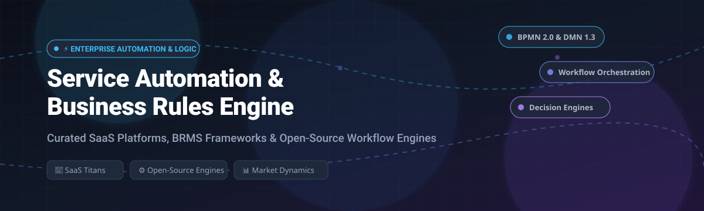

# ⚡ Awesome Service Automation &amp; Business Rules Engine 🚀

  
  
  
  
  
  
  

> 🎯 A curated directory of premier **Service Automation platforms** and **Business Rules Engines (BRE / BRMS)** — featuring enterprise SaaS solutions, cloud workflow engines, and production-grade open-source rule frameworks for automating business decisions, DMN tables, and distributed process orchestrations.

✨ **Star this repository if you find it helpful!** 🌟

---

## 📋 Table of Contents 📑

- [📈 Sector Overview & Market Dynamics](#-sector-overview--market-dynamics)
- [🏢 SaaS / Hosted Platforms](#-saas--hosted-platforms)
- [💻 Open-Source Software](#-open-source-software)
- [📊 Feature Comparison Matrix](#-feature-comparison-matrix)
- [⭐ Star History](#-star-history)
- [💖 Support & Sponsorship](#-support--sponsorship)
- [🤝 Contributing](#-contributing)
- [📄 License](#-license)

---

## 📈 Sector Overview & Market Dynamics 🌐

The global **Business Rules Engine (BRE / BRMS)** and **Service Automation / Automation-as-a-Service (AaaS)** market represents a combined sector valued at **$12.5B–$15B in 2024–2025**, projected to surge past **$45B+ by 2030** at an annual CAGR of **15%–24%**, accelerated by agentic AI and intelligent workflow orchestration. 

Structurally, the market is **moderately concentrated at the enterprise core** — where tech titans like Microsoft, Salesforce, and ServiceNow command massive platform lock-in for enterprise data and CRM/ITSM workflows — yet **increasingly fragmented across specialized decision logic, embeddable microservice rules, and self-hosted open-source automation platforms** competing for developer adoption.

---

## 🏢 SaaS / Hosted Platforms ☁️

Commercial, cloud-hosted Service Automation and Business Rules Engine platforms, sorted in descending order by parent company scale (market capitalization / enterprise valuation).

| 🏷️ Platform | 🏛️ Parent Company & Scale (Market Cap / Valuation) | 💵 Starting Pricing (Specific Tier) | 🎁 Free Tier / Trial Limits | ⚙️ Core Focus & Engine Type |
|---|---|---|---|---|
| **[Microsoft Power Automate](https://powerautomate.microsoft.com/)** | 🏢 Microsoft (~$3.1T Market Cap) | **$15 per user/month** (Power Automate Premium plan; or $0.60 per flow run via Power Automate Process plan at $150/bot/month) | **90-day free trial** (unlimited cloud flow creation, premium connectors & desktop RPA testing within trial capacity limits) | 🔄 Low-code workflow automation, desktop/cloud RPA & D365/M365 native connectors |
| **[Salesforce Flow](https://www.salesforce.com/)** | ☁️ Salesforce (~$280B Market Cap) | **$25 per user/month** (Starter Suite / Sales Cloud Starter tier billed annually) | **30-day free trial** (full access to standard Salesforce sandbox & Flow Builder with sample records) | ⚡ Platform-native visual workflow automation, event-triggered record flows & approval processes |
| **[ServiceNow Flow Designer](https://www.servicenow.com/)** | 💼 ServiceNow (~$190B Market Cap) | **~$70–$100 per fulfiller/month** (ITSM Foundation / Professional entry-tier fulfiller seat, annual contract) | **Free forever Personal Developer Instance (PDI)** (full sandbox access via ServiceNow Developer Program; hibernates after 10 hours idle; reclaims if inactive for 10 days) | 🎫 Enterprise ITSM/CSM workflow orchestration, low-code decision triggers & catalog automations |
| **[Jira Automation](https://www.atlassian.com/software/jira/features/automation)** | 🎯 Atlassian (~$50B Market Cap) | **$8.15 per user/month** (Jira Standard plan; or $16 per user/month on Jira Premium for global multi-project automation) | **Free forever plan** for up to 10 users with **100 rule executions per month** (single-project scope) | 📋 Native trigger-condition-action rule builder for agile project workflows & issue lifecycles |
| **[Nintex Process Platform](https://www.nintex.com/)** | 📑 Nintex (~$2B Private Valuation / Thoma Bravo) | **~$2,083 per month** ($25,000 billed annually for Pro package) | **30-day free trial** (access to Nintex Workflow Cloud, forms & process modeling; restricted test execution volume, no credit card required) | 📝 End-to-end process mapping, document generation (DocGen), digital forms & enterprise approval workflows |
| **[Camunda](https://camunda.com/)** | 🔄 Camunda (~$1B+ Valuation) | **Custom Enterprise contract** (typically ~$50,000/year base for production Zeebe cloud clusters) | **30-day free trial** with full SaaS cluster execution, Zeebe engine, Operate & Tasklist; converts to **Free forever tier** restricted to unlimited web BPMN/DMN modeling | 📐 Enterprise-grade standards-based BPMN 2.0 process orchestration & DMN 1.3 decision tables |

---

## 💻 Open-Source Software 🔓

Self-hosted, developer-friendly open-source business rules engines and workflow automation frameworks, sorted in descending order by GitHub stargazers count.

| 📦 Project | ⭐ GitHub Stars | 🛠️ Primary Stack | 📜 License | 🔍 Description & Architectural Highlights |
|---|---|---|---|---|
| **[n8n](https://github.com/n8n-io/n8n)** |  | TypeScript / Node.js | Fair-code (Sustainable Use) | 🤖 Leading workflow automation platform with 400+ native connectors, visual canvas, inline JS/Python code execution, and advanced AI-agent orchestration nodes. |
| **[Conductor](https://github.com/conductor-oss/conductor)** |  | Java | Apache-2.0 | 🎼 Microservices orchestration and workflow engine originally built by Netflix to manage distributed service execution, state machines, and API task workers. |
| **[Kestra](https://github.com/kestra-io/kestra)** |  | Java | Apache-2.0 | ⏱️ Declarative, event-driven data and service orchestration platform that defines and runs complex workflows and scheduled pipelines using intuitive YAML configurations. |
| **[Activepieces](https://github.com/activepieces/activepieces)** |  | TypeScript | MIT | 🧩 Permissively licensed, no-code workflow automation engine designed as an open-source alternative to Zapier, supporting 500+ modular piece connectors. |
| **[Temporal](https://github.com/temporalio/temporal)** |  | Go | MIT | ⏳ Durable execution platform guaranteeing code-based workflow state, reliable retry logic, and fault-tolerant microservice orchestration across multi-language SDKs. |
| **[Node-RED](https://github.com/node-red/node-red)** |  | JavaScript / Node.js | Apache-2.0 | 🔴 Visual flow-based programming environment from the OpenJS Foundation, connecting APIs, hardware peripherals, and online services via message-passing nodes. |
| **[Flowable](https://github.com/flowable/flowable-engine)** |  | Java | Apache-2.0 | 🌊 Compact, high-performance BPMN 2.0, CMMN 1.1, and DMN 1.2 workflow and business decision engine suitable for embedded Java microservices or standalone clusters. |
| **[Apache KIE Drools](https://github.com/apache/incubator-kie-drools)** |  | Java | Apache-2.0 | 🧠 Veteran open-source Business Rules Management System (BRMS) featuring Rete/PHREAK forward/backward chaining inference, complex event processing (CEP), and DMN tables. |
| **[Easy Rules](https://github.com/j-easy/easy-rules)** |  | Java | MIT | 🍃 Simple, lightweight POJO-based Java rules engine providing declarative rule composition via annotations, MVEL/SpEL expressions, and composite execution rules. |
| **[LiteFlow](https://github.com/dromara/liteflow)** |  | Java | Apache-2.0 | ⚡ Lightweight, flexible rule and logic flow orchestration engine decomposing enterprise backend business logic into pluggable, scriptable components. |
| **[json-rules-engine](https://github.com/CacheControl/json-rules-engine)** |  | JavaScript / TypeScript | MIT | 📋 Fast rules engine that evaluates conditions specified as readable JSON structures, supporting boolean logic, custom operators, and event-based outputs. |
| **[GoRules Zen Engine](https://github.com/gorules/zen)** |  | Rust / Go / Python / Node.js | MIT | 🚀 High-performance, embeddable business rules engine supporting JSON Decision Models (JDM), decision tables, ZEN expression language, and dynamic decision graphs. |
| **[RuleGo](https://github.com/rulego/rulego)** |  | Go | Apache-2.0 | 🌐 Lightweight, high-performance rule engine written in Go for event-driven IoT architecture, asynchronous stream data routing, and component orchestration. |

---

## 📊 Feature Comparison Matrix ⚖️

| 🛠️ Solution | 🏷️ Model | 💻 Stack | 🧠 Rules Engine | 🔄 Workflow Orchestration | 🚀 Deployment | 🎯 Target Use Case |
|---|---|---|---|---|---|---|
| **Microsoft Power Automate** | SaaS | Cloud / Azure | ❌ Basic Conditions | ✅ Advanced (Low-code/RPA) | Cloud SaaS | Enterprise M365/Azure business users |
| **Salesforce Flow** | SaaS | Cloud | ⚠️ Formula Logic | ✅ Visual Record Orchestration | Cloud SaaS | Salesforce CRM operations & sales workflows |
| **ServiceNow Flow** | SaaS | Cloud | ⚠️ Business Rules | ✅ Enterprise IT/HR Workflows | Cloud SaaS | ITSM, CSM, and enterprise service catalogs |
| **Jira Automation** | SaaS | Cloud | ⚠️ Trigger-Action | ✅ Issue Lifecycles | Cloud SaaS | Agile issue triage & Atlassian ecosystem |
| **Nintex** | SaaS | Cloud / Hybrid | ⚠️ Business Logic | ✅ Form & Doc Workflows | Cloud / Hybrid | Regulated enterprise compliance & DocGen |
| **Camunda** | Commercial / Self-Managed | Java / Zeebe | ✅ DMN 1.3 | ✅ BPMN 2.0 Standards | SaaS or Kubernetes | High-throughput distributed business processes |
| **n8n** | Open Core | Node.js | ⚠️ Filter/Code Nodes | ✅ Visual Node Graph | Self-Hosted / Cloud | Tech-savvy teams automating multi-app flows |
| **Conductor** | Open Source | Java | ⚠️ Switch/Decision Tasks | ✅ Microservices DAG | Kubernetes / Cloud | Distributed microservice orchestration |
| **Kestra** | Open Source | Java | ⚠️ Conditional Tasks | ✅ Event-Driven YAML DAG | Docker / Kubernetes | Modern data & infrastructure pipelines |
| **Activepieces** | Open Source | TypeScript | ⚠️ Flow Branches | ✅ Modular No-Code Flow | Self-Hosted / Docker | Self-hosted Zapier alternative with MIT license |
| **Temporal** | Open Source | Go / Multi-SDK | ⚠️ Code Logic | ✅ Code-as-Workflow DAG | Self-Hosted / Cloud | Mission-critical code-first distributed tasks |
| **Flowable** | Open Source | Java | ✅ DMN Decision Tables | ✅ BPMN / CMMN / DMN | Embedded / Server | Java enterprise applications requiring BPMN/DMN |
| **Drools** | Open Source | Java | ✅ Inference + DMN + CEP | ⚠️ Via jBPM | Embedded / Server | High-complexity rules, compliance & fraud scoring |
| **GoRules Zen** | Open Source | Rust / Multi-language | ✅ JDM Decision Tables | ❌ Embeddable Library | Embedded Library | Microsecond microservice pricing & eligibility rules |

---

## ⭐ Star History 📈

---

## 💖 Support & Sponsorship ☕

Thank you so much for exploring this curated list! Maintaining open research, keeping benchmarks fresh, and curating open-source resources takes continuous dedication.

If this repository saved you engineering hours, helped you architect a system, or introduced you to your next favorite automation engine:

- ⭐ **Star this repository** to help others discover it.
- 🍴 **Fork it** and contribute your own discoveries.
- 📢 **Share it** on X / LinkedIn / Reddit with fellow engineers and architects.
- ☕ **Buy me a coffee & sponsor ongoing work:**  
  

Your support is deeply appreciated! 🙌

---

## 🤝 Contributing 🚀

Contributions are warmly welcome! If you know of an open-source Service Automation platform or Business Rules Engine that should be listed here:

1. 🍴 Fork this repository.
2. 📝 Add the project to the relevant section maintaining stargazers count order.
3. 🏷️ Include the project's name, GitHub repository link, star badge, technology stack, license, and a concise summary.
4. 🚀 Submit a Pull Request.

---

## 📄 License ⚖️

This compilation is licensed under [CC0 1.0 Universal (Public Domain)](LICENSE). Listed software projects, trademarks, and logos belong to their respective copyright holders.

---

  ⭐ <b>If this curated list helps you select the right automation tool or rules engine, please consider starring this repository!</b> ⭐

